<div align="center">


<br/>


<br/><br/>

<a href="#hall-of-fame">Hall of Fame</a> ·
<a href="#changelog">Changelog</a> ·
<a href="#ctf-record">CTF Record</a> ·
<a href="#talks">Talks</a> ·
<a href="#live-from-the-india-threat-tracker">Live Intel</a> ·
<a href="#experience">Experience</a> ·
<a href="#projects">Projects</a> ·
<a href="#arsenal">Arsenal</a> ·
<a href="#certificates">Certificates</a> ·
<a href="#writing">Writing</a>

<sub>Credited as <b>Sohan Kanna D</b> on disclosure listings</sub>

</div>

CSE student working in the gap between how systems are **built** and how they **break**.
Days go into malware samples, Ghidra disassembly and SIEM pipelines. Nights go into CTFs
and vulnerability research. Organizations including the **World Health Organization**, the
**United Nations**, **IBM** and **Bosch** have acknowledged my disclosures.

---

## Hall of Fame

<div align="center">

<table>
<tr>
<td align="center" width="25%">
<br/>
<a href="https://www.who.int/about/cybersecurity/vulnerability-hall-of-fame/ethical-hacker-list"><b>World Health Organization</b></a><br/><sub>Security Hall of Fame</sub><br/><sub><code>Remote Code Execution</code></sub>
</td>
<td align="center" width="25%">
<br/>
<a href="https://unite.un.org/en/un-information-security-hall-fame"><b>United Nations</b></a><br/><sub>Information Security Hall of Fame</sub><br/><sub><code>Broken authentication</code></sub>
</td>
<td align="center" width="25%">
<br/>
<a href="https://www.ibm.com/support/pages/ibm-product-security-incident-response-team-news"><b>IBM</b></a><br/><sub>PSIRT acknowledgment</sub><br/><sub><code>Critical severity</code></sub>
</td>
<td align="center" width="25%">
<br/>
<a href="https://psirt.bosch.com/hall-of-fame/websites-hall-of-fame.html"><b>Bosch</b></a><br/><sub>Websites Hall of Fame</sub><br/><sub><code>Misconfiguration</code></sub>
</td>
</tr>
<tr>
<td align="center" width="25%">
<br/>
<a href="https://www.philips.com/a-w/security/coordinated-vulnerability-disclosure/hall-of-honors.html"><b>Philips</b></a><br/><sub>Hall of Honors</sub><br/><sub><code>Coordinated disclosure</code></sub>
</td>
<td align="center" width="25%">
<br/>
<a href="https://github.com/docmost/docmost/security/advisories/GHSA-qpw3-hp8j-27mf"><b>Docmost</b></a><br/><sub>GitHub advisory · credited</sub><br/><sub><code>GHSA-qpw3-hp8j-27mf</code></sub>
</td>
<td align="center" width="25%">
<br/>
<b>Thales Group</b><br/><sub>Letter of appreciation</sub><br/><sub><code>Default credentials</code></sub>
</td>
<td align="center" width="25%">
<br/>
<b>DSCI</b><br/><sub>VDP letter of appreciation</sub><br/><sub><code>Data Security Council of India</code></sub>
</td>
</tr>
</table>

<sub>`8 acknowledged · CERT-In in triage · coordinated disclosure only · no unauthorized testing` · names link to the public listing</sub>

</div>

---

## Changelog

```diff
@@ sohankanna — recent activity @@
+ [2026-10]  Joined Razorpay as AI Builder Intern
+ [2026-10]  Docmost · DoS disclosure → GitHub advisory GHSA-qpw3-hp8j-27mf, credited
+ [2026-10]  KPMG Cyber Threat Flag 2026 · 470 pts, 27 solves · 22 writeups published
+ [2026-08]  Speaker · null × OWASP Bengaluru meetup · "From Suspicious File to First Verdict"
+ [2026-08]  World Health Organization · RCE disclosure → Security Hall of Fame
! [pending]  CERT-In · triaged, listing pending
```

<sub>Older entries live in the [Hall of Fame](#hall-of-fame) and [CTF Record](#ctf-record) below.</sub>

---

## CTF Record

<div align="center">

<table>
<tr>
<td align="center" width="20%">
<br/>
<a href="https://www.sohankanna.com/walkthroughs?page=2"><b>CloudSEK CTF 2025</b></a><br/><sub><b>13th</b> / ~1,600 · top 1%</sub><br/><sub><code>solo · 4 writeups</code></sub>
</td>
<td align="center" width="20%">
<br/>
<b>HTB Cyber Apocalypse 2026</b><br/><sub><b>325th</b> / 6,744 teams</sub><br/><sub><code>top 5%</code></sub>
</td>
<td align="center" width="20%">
<br/>
<b>BSides Bangalore B5CTF 2025</b><br/><sub><b>5th</b> / ~50 teams</sub><br/><sub><code>won conference passes</code></sub>
</td>
<td align="center" width="20%">
<br/>
<a href="https://www.sohankanna.com/walkthroughs/series/kpmg-ctf-2026-campus-edition"><b>KPMG Cyber Threat Flag 2026</b></a><br/><sub><b>470 pts</b> · 27 solves</sub><br/><sub><code>solo · 22 writeups</code></sub>
</td>
<td align="center" width="20%">
<br/>
<a href="https://ctftime.org/team/378344"><b>CTFtime 2025</b></a><br/><sub>Diamond_Dogs</sub><br/><sub><code>#40 in India</code></sub>
</td>
</tr>
</table>

<sub>Full logbook with certificates and takeaways → [ctf-trophy-case](https://github.com/sohankanna/ctf-trophy-case)</sub>

</div>

---

## Talks

<table>
<tr>
<td width="46%" valign="middle">
<a href="https://drive.google.com/file/d/1sFAGZS_kc1tcIjtWGHbZio5MXMJZTott/view?usp=sharing">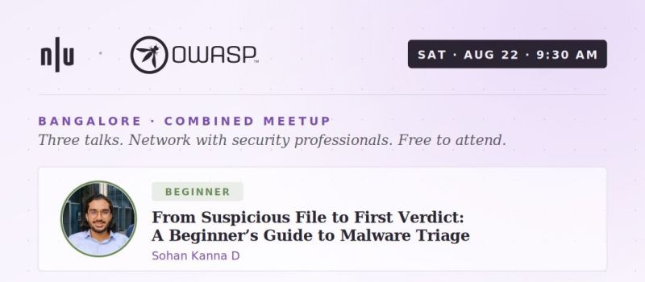</a>
</td>
<td valign="middle">

**From Suspicious File to First Verdict: A Beginner's Guide to Malware Triage**

null × OWASP Bengaluru combined meetup · SecureSips by CloudSEK · **22 Aug 2026**

[Slides](https://drive.google.com/file/d/1sFAGZS_kc1tcIjtWGHbZio5MXMJZTott/view?usp=sharing)

</td>
</tr>
</table>

---

## Live from the India Threat Tracker

<!-- TRACKER:START -->
<div align="center">

<a href="https://www.sohankanna.com/tracker/vulnerabilities"></a>

<sub>Open: [`CVE-2026-19868`](https://www.sohankanna.com/tracker/vulnerabilities?cve=CVE-2026-19868) · [`CVE-2026-118527`](https://www.sohankanna.com/tracker/vulnerabilities?cve=CVE-2026-118527) · [`CVE-2026-111357`](https://www.sohankanna.com/tracker/vulnerabilities?cve=CVE-2026-111357) · [`CVE-2026-97229`](https://www.sohankanna.com/tracker/vulnerabilities?cve=CVE-2026-97229) · redrawn daily from the [India Threat Tracker](https://www.sohankanna.com/tracker)</sub>

</div>
<!-- TRACKER:END -->

---

## Experience

&nbsp; **AI Builder Intern** · Razorpay &nbsp;<sub>`Oct 2026 → present`</sub>

&nbsp; **Technical Lead & Co-founder** · ZeroCrypt, Cybersecurity Club &nbsp;<sub>`Sep 2025 → Oct 2026`</sub><br/>
Architected distributed lab infrastructure with Docker and AWS for attack simulations. Ran hands-on workshops for **40+ students**.

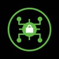&nbsp; **Security Intern** · BytesEncrypt<br/>
Built an end-to-end blue-team training platform on Node.js and AWS, and authored **40–50 hands-on labs** covering threat detection, log analysis and incident response.

&nbsp; **Security Researcher** · Independent<br/>
Critical and high-severity findings through coordinated disclosure: an RCE acknowledged by the **WHO**, broken authentication on un.org acknowledged by the **United Nations**, and a critical-severity issue acknowledged by **IBM PSIRT**.

---

## Projects

<table>
<tr>
<td width="50%" valign="top">

### ❯ [India Threat Tracker](https://github.com/sohankanna/india-threat-tracker)

An India-focused threat-intelligence tracker: a data product that follows campaigns and actors targeting India, paired with plain-language explainers.

`Threat Intel` · `CTI` · `India`

</td>
<td width="50%" valign="top">

### ❯ [not-strangers](https://github.com/sohankanna/not-strangers)

Graph-based payment abuse detection that finds fraud rings by the relationships between accounts, not just individual transactions.

`Fraud Detection` · `Graphs` · `Payments`

</td>
</tr>
<tr>
<td width="50%" valign="top">

### ❯ [Malware Analysis Collection](https://github.com/sohankanna/Malware-Analysis-Collection)

Technical teardowns of live malware samples, phishing kits and scam infrastructure. Ships IOCs, reverse-engineering notes and de-obfuscated payloads for each case.

`Reverse Engineering` · `Threat Intel` · `OSINT`

</td>
<td width="50%" valign="top">

### ❯ [Android VpnHijacker Analysis](https://github.com/sohankanna/Android-VpnHijacker-d629c60a)

Static and dynamic analysis of an advanced Android spyware sample that fakes an SBI login page for credential theft while a hidden VpnService silently intercepts all device traffic.

`Android RE` · `Spyware` · `Traffic Interception`

</td>
</tr>
<tr>
<td width="50%" valign="top">

### ❯ [NPM Supply Chain Attack — Sept 2025](https://github.com/sohankanna/npm-supply-chain-attack-analysis-2025)

Breakdown of the malware behind the September 2025 NPM compromise that hit `chalk`, `debug` and 16 other packages, tracing the injected payload end to end.

`Supply Chain` · `JavaScript` · `Malware Analysis`

</td>
<td width="50%" valign="top">

### ❯ [CloudLog Sentinel](https://github.com/sohankanna/cloudlog-sentinel)

A cloud-native SIEM written in Java and Spring Boot that ingests AWS CloudTrail logs and raises real-time detections against them.

`Java` · `Spring Boot` · `AWS CloudTrail` · `SIEM`

</td>
</tr>
</table>

**Also in the repo:**
[Enterprise AD Hardening](https://github.com/sohankanna/Enterprise-Active-Directory-Hardening-Project) ·
[Insider Threat Dashboard](https://github.com/sohankanna/Insider-Threat-Detection-Dashboard) ·
[Wazuh SOC Lab](https://github.com/sohankanna/Wazuh-SOC-Lab) ·
[SOC Analyst Portfolio](https://github.com/sohankanna/SOC-Analyst-Portfolio) ·
[Secure Code Review Handbook](https://github.com/sohankanna/secure-code-review-handbook) ·
[Phishing Simulator](https://github.com/sohankanna/PhishingSimulator) ·
[TryHackMe Walkthroughs](https://github.com/sohankanna/TryHackMe-Walkthroughs) ·
[CTF Trophy Case](https://github.com/sohankanna/ctf-trophy-case)

---

## Arsenal

```console
$ tree ~/arsenal
~/arsenal
├── malware-analysis/   static + dynamic analysis, deobfuscation, Ghidra, IOC extraction
├── security-ops/       SIEM + EDR tuning, log analysis, alert triage, incident response
├── appsec/             OWASP Top 10, web + API vulnerability hunting
└── offensive/          web/API pentesting, phishing simulation, social engineering
```

<p align="center">


</p>
<p align="center">


</p>

---

## Certificates

<p align="center">


</p>
<p align="center">


</p>

<sub>Certificates and verification links ↓</sub>

<details>
<summary><b>❯ Hack The Box</b></summary>
<br/>

| CERTIFICATION | STATUS |
| :--- | :--- |
| Certified Defensive Security Analyst (CDSA) | `[+] earned` |
| Certified Junior Cybersecurity Associate (CJCA) | `[+] earned` |


</details>

<details>
<summary><b>❯ TryHackMe</b></summary>
<br/>

| LEARNING PATH | STATUS |
| :--- | :--- |
| SOC Level 1 | `[+] completed` |
| Jr Penetration Tester | `[+] completed` |
| Cyber Security 101 | `[+] completed` |
| Web Fundamentals | `[+] completed` |


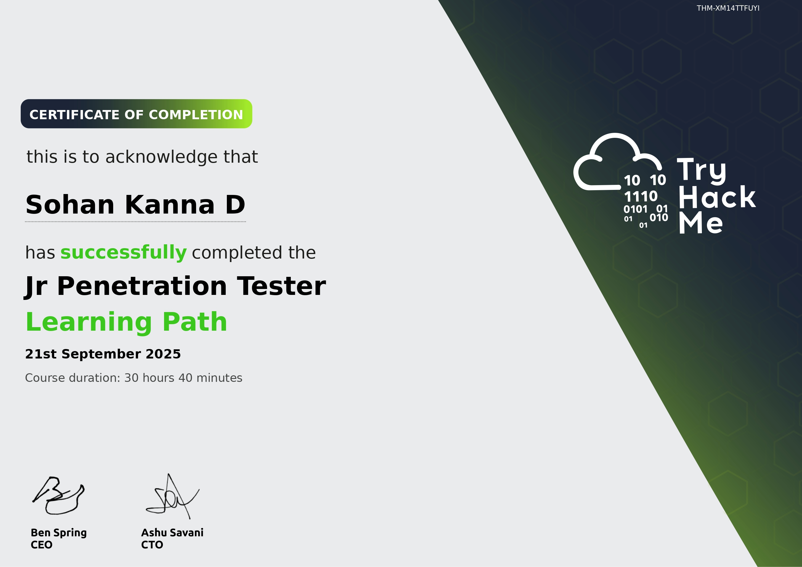
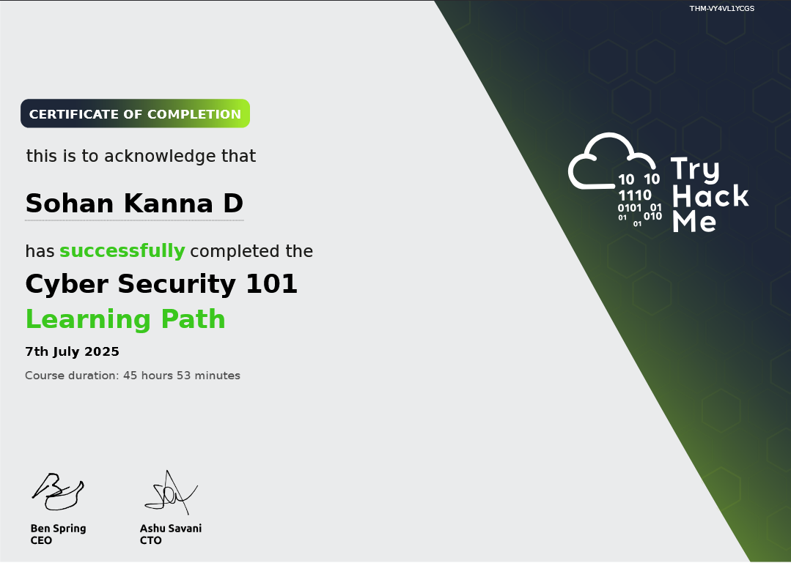
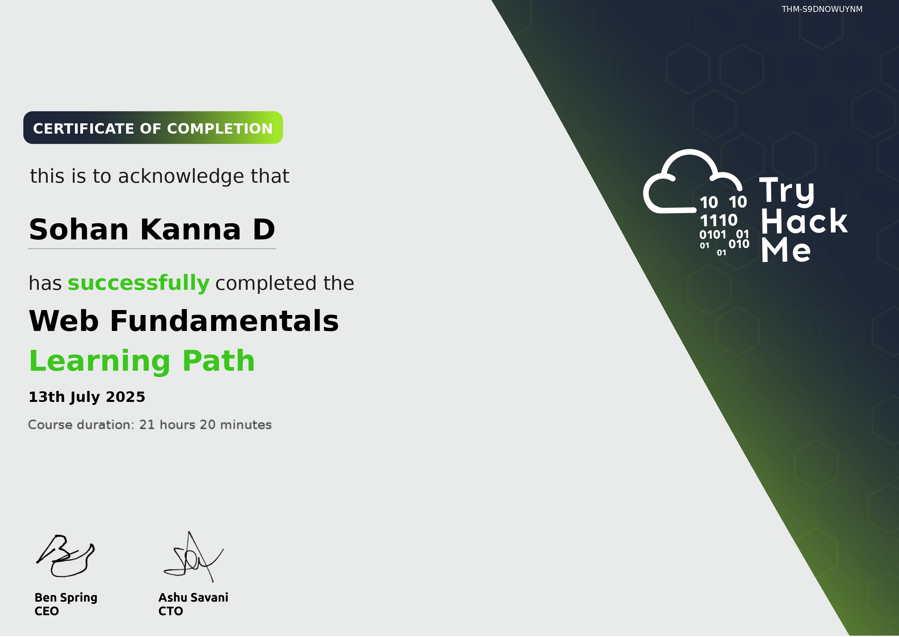

</details>

<details>
<summary><b>❯ LetsDefend</b></summary>
<br/>

| CERTIFICATE / BADGE | VERIFY |
| :--- | :---: |
| SOC Analyst Fundamentals | [verify](https://app.letsdefend.io/certificate/show/7f970376-3faf-4673-aa48-db46b81a847e) |
| Malware Analysis | [verify](https://app.letsdefend.io/certificate/show/c0d346a1-d7da-4ee1-8c3a-bd445f6273eb) |
| Web Attack Detection and Analysis | [verify](https://app.letsdefend.io/certificate/show/fd7c977e-6f79-4842-85bf-43641389f230) |
| Programming for Cybersecurity | [verify](https://app.letsdefend.io/certificate/show/06d1ae83-cf3b-4189-96e2-f498de03a109) |
| Non Stop — badge | [verify](https://app.letsdefend.io/my-rewards/detail/a3cccbd1-5060-40e8-9722-6ca17c212a03) |
| Hunter II — badge | [verify](https://app.letsdefend.io/my-rewards/detail/b88c01b5cb0c4776b4437d7a7765a5f0) |
| Hunter — badge | [verify](https://app.letsdefend.io/my-rewards/detail/d61af313b6d949d98b9ada4e667dc458) |

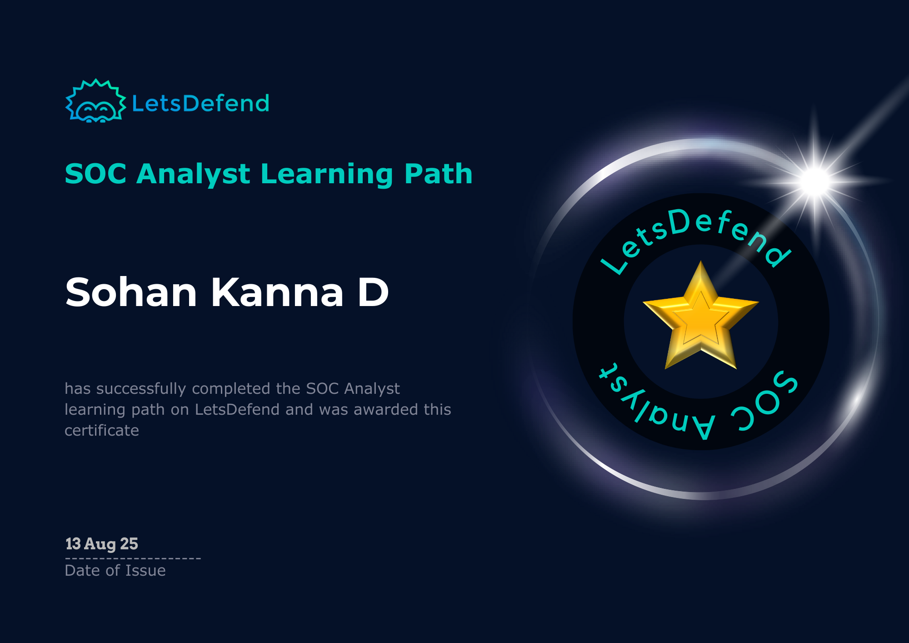
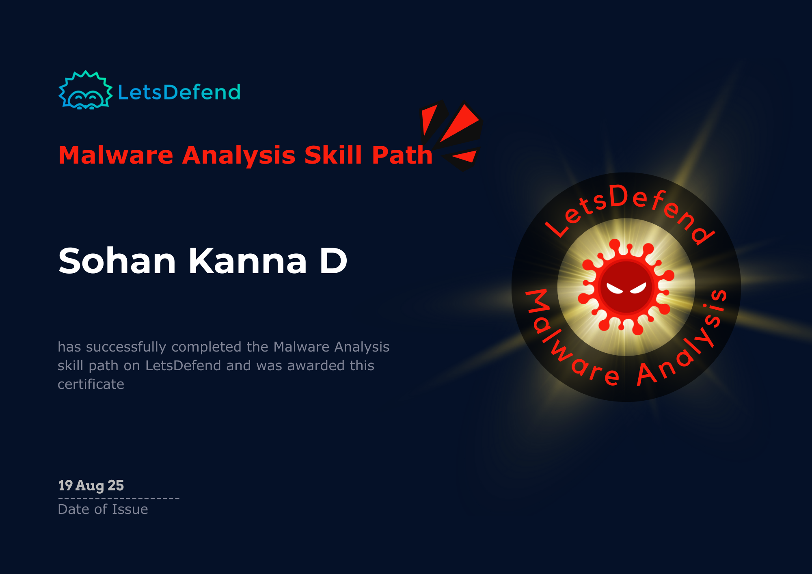
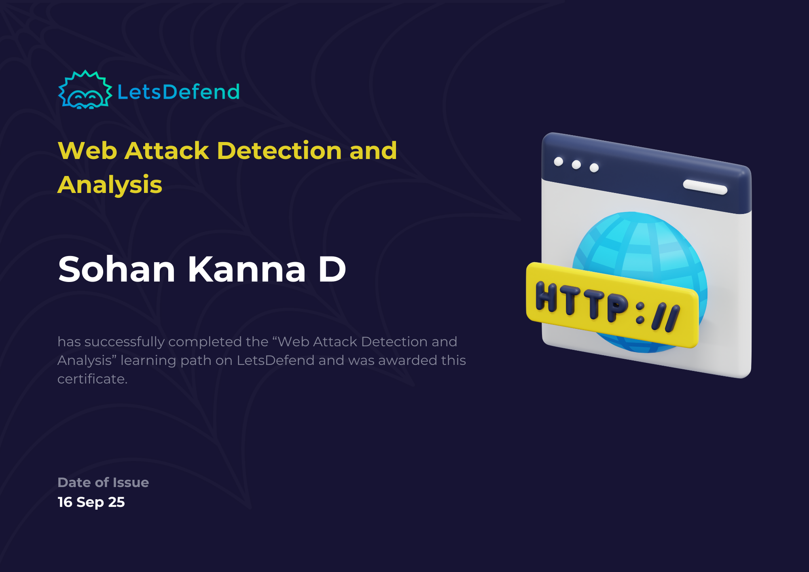
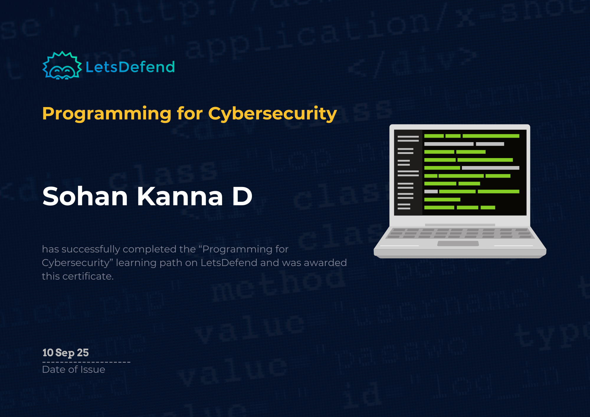

</details>

<details>
<summary><b>❯ (ISC)² · NPTEL · Google</b></summary>
<br/>

| CERTIFICATION | ISSUER |
| :--- | :--- |
| Certified in Cybersecurity (CC) | (ISC)² |
| Network Security | NPTEL — IIT Bombay |
| [Google Cybersecurity Professional Certificate](https://www.coursera.org/account/accomplishments/specialization/C9Z75MHGWLCQ) | Google |

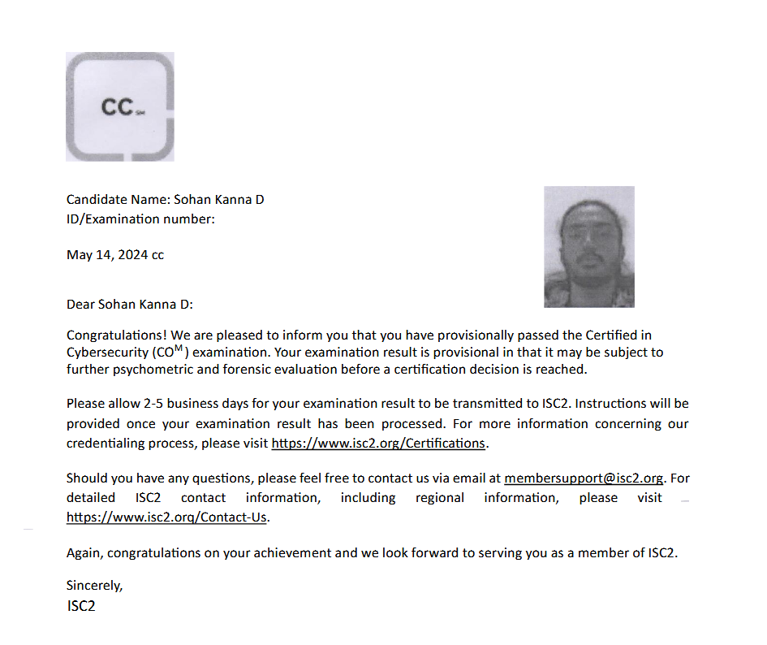
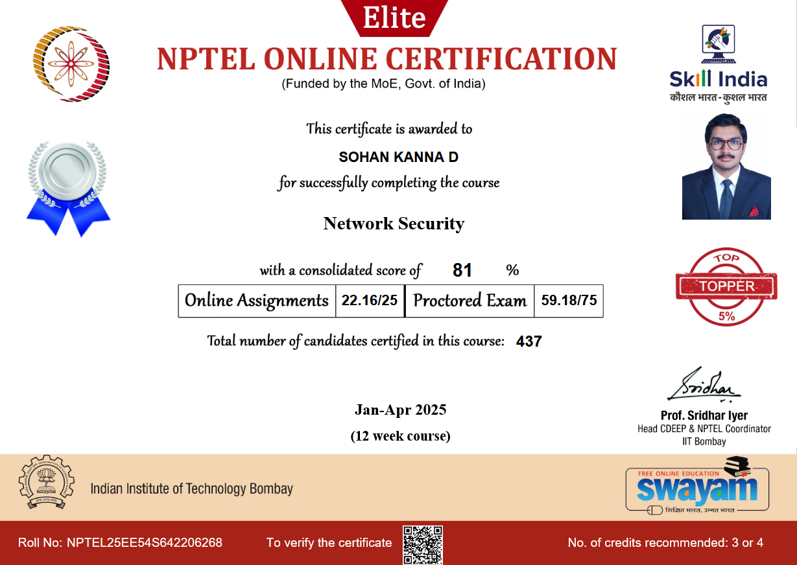
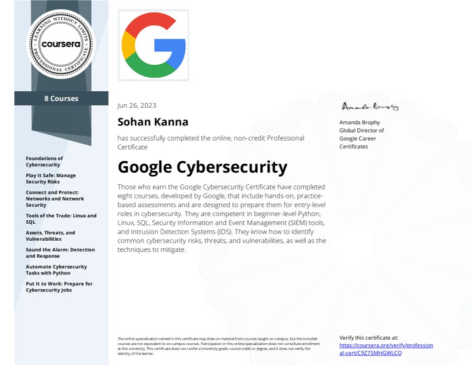

</details>

---

## Writing

I publish deep-dives on malware analysis, reverse engineering, threat intelligence and
unpacking heavily obfuscated code on my site, cross-posted to Medium. My write-up on
**Chrome zero-day exploitation** has crossed **6,000+ reads**, and my latest series covers
all 22 challenges I wrote up from **KPMG CTF 2026**.

**Latest posts**

<!-- BLOG-POST-LIST:START -->
- [All posts on Medium](https://medium.com/@sohankanna)
<!-- BLOG-POST-LIST:END -->

<div align="center">
<a href="https://www.sohankanna.com">
  
</a>
<a href="https://www.sohankanna.com/walkthroughs/series/kpmg-ctf-2026-campus-edition">
  
</a>
<a href="https://medium.com/@sohankanna">
  
</a>
</div>

---

<div align="center">


<br/><br/>

<a href="https://www.linkedin.com/in/sohan-kanna/">
  
</a>
<a href="https://x.com/sohankanna">
  
</a>
<a href="https://www.sohankanna.com">
  
</a>
<a href="https://medium.com/@sohankanna">
  
</a>

<br/><br/>

<sub>`coordinated disclosure only · no unauthorized testing`</sub>

</div>
